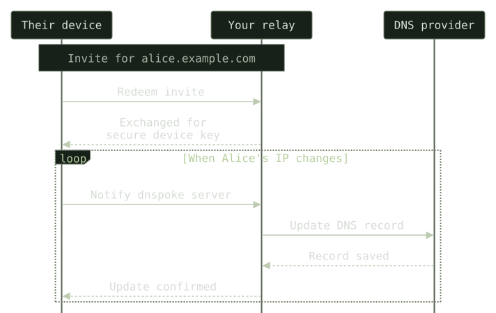

# `dnspoke`

Say you give a friend or teammate `alice.example.com` for their home server or development machine. Every time their public IP changes, they need you to update DNS—or you need to give them access to your DNS account.

`dnspoke` lets them handle those changes themselves. Run the relay, send them a one-time invite scoped to their hostname, and their client keeps that hostname pointed at their current public IP. They can manage their own address without touching anyone else's records, and your DNS-provider credentials stay on your server.

`dnspoke` is self-hosted, works with [DNS Lexicon](https://dns-lexicon.github.io/dns-lexicon/) providers, and supports background updates on macOS, Linux, and Windows.



The client checks periodically and starts each connection to the relay. The relay updates the assigned DNS record and sends the result back to the client.

## For DNS owners

### 1. Set up the relay

```sh
git clone https://github.com/brandonscript/dnspoke.git
cd dnspoke
cp .env.example .env
```

Edit `.env` with your relay address, DNS zone, provider, and the credentials required by [DNS Lexicon](https://dns-lexicon.github.io/dns-lexicon/configuration_reference.html):

```dotenv
RELAY_PUBLIC_URL=https://dns.example.com
DNS_ZONE=example.com
DNS_PROVIDER=your_provider
```

`RELAY_PUBLIC_URL` is where the relay is hosted. Omit it to generate and save a random eight-character hex hostname on first startup; run `dnspoke admin endpoint` inside the server container to see it. Use `dnspoke admin endpoint --enroll-at HOSTNAME` to save a custom address when no environment override is set. `DNS_ZONE` is the zone it manages. Configure these once; each invite includes the relay address automatically.

Connect the service to your HTTPS proxy's Docker network, set its trusted proxy address in `.env`, then start it:

```sh
docker compose -f compose.example.yml up -d --build
```

See [server configuration](docs/server.md) for the network, credentials, storage, and proxy setup.

The same CLI includes client and local admin commands. Homebrew installs it without server dependencies; the Docker image includes the full relay server. Administration requires access to the server database and environment.

### 2. Invite a client

```sh
docker compose -f compose.example.yml exec dnspoke dnspoke admin invite alice
```

This grants access to `alice.example.com` only. Example output:

```text
Hostname: alice.example.com
Server: https://dns.example.com
Expires in: 900s
One-time invite (share privately): Mi8BI0VniavN7wEjRWdkbnMuZXhhbXBsZS5jb20
```

The example code is not valid. A real invite contains a random secret and the relay address, both encoded together. Send the complete code privately along with the client instructions below.

Invites expire after 15 minutes and can be used once. Use `invite alice --ttl 600` for a ten-minute invite. Longer invites require explicit opt-in: `invite alice --ttl 86400 --yolo` creates a 24-hour invite, the maximum allowed. To let a client update an existing A record, inspect it first and add `--adopt-existing`.

### 3. Manage access

```sh
docker compose -f compose.example.yml exec dnspoke dnspoke admin devices
docker compose -f compose.example.yml exec dnspoke dnspoke admin revoke DEVICE_ID
docker compose -f compose.example.yml exec dnspoke dnspoke admin audit
```

Device listings include the device ID, its reported local hostname (`device_hostname`), assigned DNS hostname, and registration date (`registered_at`, in UTC). The local hostname is captured at enrollment; older clients show `null`.

One active device is allowed per hostname. Revoke a device before replacing it. Revocation disables its credential and outstanding update tokens; the DNS record stays in place.

## For invited clients

### Install and enroll

On macOS and Linux, Homebrew is the primary installation method:

```sh
brew install brandonscript/tap/dnspoke
dnspoke enroll
```

On Windows, use the [PowerShell installer](docs/install.md#windows-powershell-installer). Linux users without Homebrew can use [install.sh](docs/install.md#linux-shell-installer). Both installers require Python 3.12+ and preserve existing enrollment when upgraded.

Paste the invite when prompted, or pass it directly:

```sh
dnspoke enroll 'Mi8BI0VniavN7wEjRWdkbnMuZXhhbXBsZS5jb20'
```

Use the real code your administrator sent, not the example above. The client saves the relay address and a device credential automatically. Enrollment lasts until the administrator revokes it.

Send an update and check your enrollment:

```sh
dnspoke update
dnspoke status
```

### Local IP privacy

The client reports its local hostname and a masked local address by default: `*.*.*.42` for IPv4 or `*::abcd` for IPv6. Masking happens on the client, so the full local address is not sent. This is the address used to reach the relay, which may belong to a VPN interface.

For debugging, share the full local address during enrollment with `dnspoke enroll --ip INVITE`. Use `--no-ip` to omit it entirely.

Change your choice later:

```sh
dnspoke configure --ip       # Share the full local IP
dnspoke configure --mask-ip  # Restore the default masked address
dnspoke configure --no-ip    # Remove the local IP from the server
```

These commands save `ip_mode` (`full`, `masked`, or `hidden`) in the client config and immediately replace or clear the server value. If the server is unreachable, the command reports failure and the next update retries the saved choice. Background updates read this setting on every check. Clearing removes the current value; it cannot remove copies in older server backups.

The relay still needs your public IP for DNS updates. This setting only controls the additional local address, and does not change hostname reporting.

### Run in the background

```sh
brew services start dnspoke
```

The default check period is five minutes. To check every 15 minutes instead:

```sh
dnspoke configure --ttl 15
brew services restart dnspoke
```

Run Homebrew services as your user, without `sudo`. Stop with `brew services stop dnspoke`. For foreground use on any supported client platform, run `dnspoke watch --ttl 15`. Script installations can use [systemd or Windows Task Scheduler](docs/install.md) for automatic startup.

For client commands, `--ttl` is the polling interval in minutes, with a minimum of five. For `dnspoke admin invite`, it is the invite lifetime in seconds.

## Details

- Only public IPv4 A records are supported. The address is the one the relay sees, so VPNs and outbound proxies affect it.
- Updates are restricted to the assigned hostname. Wildcards, other records, and the zone apex are left alone.
- Device credentials are stored in `~/.config/dnspoke/device.json` on macOS/Linux or `%LOCALAPPDATA%\dnspoke\device.json` on Windows. `XDG_CONFIG_HOME` overrides the base directory. Unix permissions must be file 600/directory 700; Windows uses a private ACL for your user.
- The client skips unchanged addresses and reconciles DNS on the first check after 24 hours. Failed updates retry with backoff.
- DNS updates do not configure router forwarding, firewall rules, or TLS for the hostname.

[Installation](docs/install.md) · [Server configuration](docs/server.md) · [Protocol and limits](docs/technical.md) · [Development](docs/development.md)

## License

[MIT](LICENSE).
